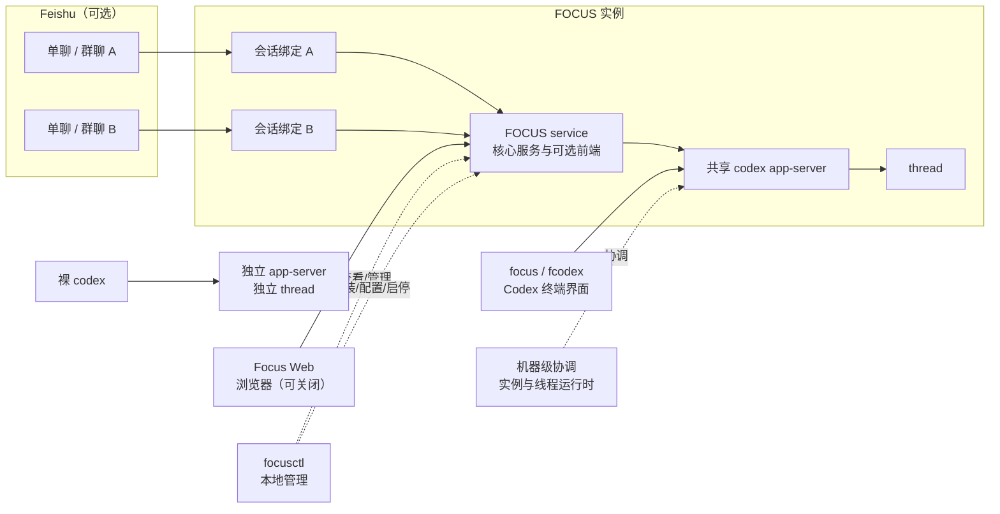

# FOCUS

**FOCUS - Feishu, Online Codex for Users and Sharing** 让浏览器、终端和飞书机器人接入同一个
Codex 后端，查看和继续同一线程。Web 默认开启，飞书按需启用；也可以只使用终端。

本项目提供：

- 浏览器前端 Focus Web，用于对话、浏览历史和管理线程
- 终端入口 `focus` / `fcodex`，使用 Codex TUI 接入同一实例的实时线程；两者是等价命令
- 可选的飞书机器人，在单聊或群聊中使用 Codex
- 本地管理命令 `focusctl`，用于配置、启停、实例和线程管理

> 本项目源自 [shenman9/feishu_bot](https://github.com/shenman9/feishu_bot) 的“飞书 + Claude Code”功能，并在此基础上演进为面向 Codex 的 FOCUS。

## 使用入口

| 入口 | 作用 | 什么时候用 |
| --- | --- | --- |
| Focus Web | 浏览器对话与线程管理 | 本机访问，或经 SSH 转发、可信 HTTPS 反向代理远程访问 |
| Focus 手机客户端 | 在独立的 Android WebView 或鸿蒙 ArkWeb 窗口使用 Focus Web | 手机切换多个 HTTPS 实例、保存可选的 HTTP Basic 凭据、恢复对话和草稿。Android 可在当前实例检查和下载安装包。[构建、安装与验收](mobile/README.md) |
| `focus` / `fcodex` | 接入同一实例后端的 Codex TUI | 在终端中查看和继续同一线程 |
| 飞书聊天命令（可选） | 已绑定线程的聊天入口 | 在飞书里提问、切线程、改当前会话设置 |
| `focusctl` | 本地管理命令 | 配置、启停、实例、线程、会话绑定与清理 |
| `focusd` | 后台服务入口 | 由系统服务管理器调用，通常不手敲 |

定位实现、修改源码及发布 Focus 的步骤见[仓库开发与验证规范](docs/architecture/development-navigation.zh-CN.md)。

## 快速开始

### 安装环境

- 带 `venv` / `ensurepip` 的 CPython 3.11+，用于首次安装或修复；安装后使用 Focus 专属 Python
- Linux 使用可用的 `systemd --user`，macOS 使用 launchd，Windows 使用 Task Scheduler
- 本机已安装 `codex` CLI，`codex --help` 可正常执行，并已配置所需的账号或 provider

### 1. 安装

macOS / Linux：

```bash
cd /path/to/focus
bash install.sh
```

Windows PowerShell：

```powershell
cd \path\to\focus
.\install.ps1
```

默认从本仓库 GitHub Releases 下载最新稳定版安装包。完整安装选项见
`bash install.sh --help` 或 `.\install.ps1 --help`；源码安装见[构建说明](docs/contracts/install-artifact-delivery.zh-CN.md#6-构建与发布是两件事)。

Windows 安装会把 `%LOCALAPPDATA%\focus\bin` 写入当前用户的 `PATH`；
通常新开一个 PowerShell / cmd 后即可直接发现 `focus`、`focusd`、`focusctl`、`fcodex`。
Windows 当前不安装 shell completion。

不要使用 `pip install .` 或 `pip install -e .`，这将安装无法被卸载命令 `focusctl uninstall/purge` 覆盖的残留命令入口。

#### 卸载

- `focusctl uninstall` 删除服务、命令入口、补全脚本与受管 `.venv`，保留配置和其他数据。
- `focusctl purge` 还会删除受管的配置与数据目录。
- 两条命令都要求所有实例处于空闲状态。

### 2. 启动服务

如需为 Codex 提供环境变量，可先编辑：

```bash
focusctl config env --open
```

启动服务：

```bash
focusctl service start
```

如需登录后自动启动：

```bash
focusctl service autostart enable
```

### 3. 打开 Web 或终端

#### 浏览器

Web 功能默认开启，在运行 Focus 的机器上执行：

```bash
focusctl web open
```

命令会输出认证链接并尝试打开默认浏览器；只需链接时，使用 `focusctl web open --no-browser`。

Focus Web 只监听本机回环地址（loopback），可通过 SSH 本地转发从远程访问。
浏览器若通过非回环地址（non-loopback external origin）访问，必须经过已配置的可信 HTTPS 反向代理。
详见 [Focus Web 自部署外部访问](docs/decisions/focus-web-external-access.zh-CN.md)。

#### 终端

在终端中开始对话，或继续已有线程：

```bash
focus
focus resume <thread_id|thread_name>
```

`fcodex` 与 `focus` 等价，可直接替换上述命令中的 `focus`。命名实例的用法见[多实例](#多实例)。

## 配置与管理

Codex 是必要依赖。Web 和飞书可独立开关；两者都关闭时，仍可使用 `focusctl` 和 `focus` / `fcodex`。

- Web 默认开启：用 `focusctl config codex --open` 编辑 `codex.yaml`，将 `web_enabled` 设为 `false` 可关闭，设为 `true` 可开启。
- 飞书默认关闭：在 `system.yaml` 设置 `feishu_enabled: true` 并填写 `app_id`、`app_secret`。
- `focus.env` 按 Codex provider 需求填写 key 或其他环境变量。

开关变更后执行 `focusctl service restart`。已有飞书配置若缺少 `feishu_enabled: true`，升级后也会关闭飞书。
完整边界见 [system.yaml 合同](docs/contracts/system-config.zh-CN.md#前端启用与生命周期)。

本地查看服务与线程：

```bash
focusctl -h
focusctl service status
focusctl thread list
focusctl thread status --thread-name <name>
focusctl thread goal --thread-name <name>
```

`focusctl --instance <name> ...` 选择已创建的命名实例，不会隐式创建实例。

## 可选：接入飞书

如需在飞书中使用 Focus，先在飞书开放平台创建应用，取得 `app_id` 与 `app_secret`，
再完成下面的权限、事件与初始化步骤。

### 1. 配置飞书应用

#### 权限

权限用途概览

  - 初始化与机器人自识别: `/init`, `/bot-status`
      - `application:application:self_manage`
  - 用户与群成员身份识别: 群成员称呼, `/whoami` 身份信息获取
      - `contact:contact.base:readonly`
      - `contact:user.base:readonly`
      - `contact:user.employee_id:readonly`
  - 群聊名称读取: `focusctl binding list --refresh-names` 刷新 `CHAT` 列群名缓存
      - `im:chat:readonly`
  - 接收单聊与群聊消息
      - `im:message.p2p_msg:readonly`
      - `im:message.group_at_msg:readonly`
      - `im:message.group_msg`
  - 读取消息、发送回复、更新卡片
      - `im:message`
      - `im:message:readonly`
      - `im:message:send_as_bot`
      - `im:message:update`
  - 发送图片到飞书
      - `im:resource`

<details>
<summary>一键导入权限 JSON（点击展开）</summary>

在飞书开放平台「权限管理」页面点击「批量开通」，粘贴以下 JSON 即可导入当前建议权限集：

```json
{
  "scopes": {
    "tenant": [
      "application:application:self_manage",
      "contact:contact.base:readonly",
      "contact:user.base:readonly",
      "contact:user.employee_id:readonly",
      "im:chat:readonly",
      "im:message",
      "im:message.group_at_msg:readonly",
      "im:message.group_msg",
      "im:message.p2p_msg:readonly",
      "im:message:readonly",
      "im:message:send_as_bot",
      "im:message:update",
      "im:resource"
    ]
  }
}
```

</details>

#### 事件与回调

在「事件与回调」中启用：

- WebSocket 长连接模式
- 事件：`im.message.receive_v1`
- 事件：`im.message.recalled_v1`（用于撤回仍在队列中的消息）
- 事件：`im.chat.disbanded_v1`（群解散后停用并清理该群的本地 binding）
- 事件：`im.chat.member.bot.deleted_v1`（机器人被移出群后停用并清理该群的本地 binding）
- 回调：`card.action.trigger`

本项目默认走长连接，不需要公网 webhook URL。

同一个飞书 `app_id` 只支持一个 Focus service 长连接。Focus 会在同一台机器上拒绝重复
连接；不要在多台机器或集群中用同一个 `app_id` 并行部署，因为飞书可能把事件投递到
任意连接，当前版本无法在跨机器场景证明持有 binding 的进程一定收到失联事件。

### 2. 启用飞书

打开系统配置：

```bash
focusctl config system --open
```

在 `system.yaml` 中设置 `feishu_enabled: true`，并填写 `app_id`、`app_secret`，然后重启服务：

```bash
focusctl service restart
```

### 3. 初始化管理员

查看初始化口令：

```bash
focusctl config init-token
```

然后在飞书里私聊机器人：

```text
/init <token>
```

这一步会把当前发送者登记为管理员，并尝试写入当前机器人的 `bot_open_id`。
非管理员普通私聊默认不能直接使用机器人；但 `/whoami`、`/bot-status`、`/init <token>` 这类身份与初始化命令仍可在私聊使用。

### 4. 开始使用

在飞书里：

- 发送 `/help` 或 `/h` 看可用命令导航
- 发送 `/commands` 看可用命令列表
- 直接发送普通文本开始对话
- 手动发送命令 `/new`、`/resume`、`/cd` 管理当前会话绑定的 thread
- 如果想让同一个机器人同时服务多个项目，建议为每个项目单独建一个群聊；每个群聊固定在自己的目录和 thread 上，避免在单聊里反复 `/cd`、`/resume`
- 群聊里管理员先用 `/group activate` 激活，再按群模式使用

### 进阶操作

在本地查看飞书绑定，或向绑定到指定线程的飞书会话发送图片：

```bash
focusctl binding list
focusctl image send --thread-id <thread_id> --path ./diagram.png
```

- `focusctl prompt send --binding-id ...` 可向某个既有 Feishu 会话合成发起一轮 prompt；若不同会话各自绑定到不同 thread，它也可作为多个 thread 之间显式协作的控制面入口。
- `/goal` 用于查看或管理当前 thread 的 goal；常用形态包括 `/goal`、`/goal text`、`/goal set <objective>`、`/goal pause`、`/goal resume`、`/goal clear`。本地查看或排障时，可配合 `focusctl thread goal --thread-name <name>` 一起用。如需让机器人帮助生成 goal 主句，可先用 `/last text` 获取当前会话最近的权威终态文本，方便在手机侧复制后再整理成主句。
- `focusctl image send` 是 thread-scoped 动作：在 Codex turn 内可依赖自动注入的 `CODEX_THREAD_ID` 把图片发回当前 thread；若目标不是当前 thread，则必须显式提供 `--thread-id` 或 `--thread-name`。
- 若在 Codex turn 中已经有本地图片文件，可用 `feishu-send-image` skill 调 `focusctl image send`，把图片发回当前 thread 当前 attached 的飞书会话；这个 skill 不负责跨 thread / 手动选目标。

## 多实例

如果需要分别配置 Web、终端工作环境或不同的飞书机器人，可以创建命名实例：

```bash
focusctl instance create corp-a
focusctl --instance corp-a service start
focusctl --instance corp-a web open
```

终端通过 `focus --instance corp-a` 或 `fcodex --instance corp-a` 接入该实例。
如需为它启用飞书，使用 `focusctl --instance corp-a config system --open` 编辑该实例的配置，
再按上面的飞书接入步骤设置；相关 `focusctl` 命令都加上 `--instance corp-a`。

每个实例有自己的：

- 配置目录
- 数据目录
- service
- shared backend

额外说明：

- 命名实例只读取自己实例目录下的 `system.yaml` / `codex.yaml`
- 它不会继承 `default` 实例的 `codex.yaml`
- 真实 `codex.yaml` 是实例级 override 文件；通常只保留显式设置过的键
- 如需查看完整可配项，应看同目录 `codex.yaml.example`

所有实例共享：

- `CODEX_HOME`
- 持久化 thread 命名空间
- 机器级 `ThreadRuntimeLease`

## 更多帮助

- 本地查看 `focus --help` 或 `fcodex --help`
- 本地查看 `focusctl --help`
- 启用飞书后，在聊天中发送 `/help` 或 `/h`
- 深入文档看[文档索引](docs/doc-index.zh-CN.md)

## 一图看懂架构

每个 FOCUS 实例拥有自己的共享后端 `codex app-server`。Web、`focus` / `fcodex` 与启用后的飞书
可以查看和操作同一条实时线程；飞书会话通过绑定选择线程。

- Web 和终端的普通输入：空闲时开始新一轮，运行中时补充当前轮；飞书普通输入排队进入后续轮。
- 模型、思考强度和权限等设置由各入口分别保存，不自动同步。从另一入口开始新一轮时，可能应用该入口的设置；运行中补充输入不改变当前轮设置。
- 直接运行 `codex` 使用独立后端，不接入 Focus 的共享线程。

详细规则见[本地命令与运行时设置合同](docs/contracts/local-command-and-thread-profile-contract.zh-CN.md)。


